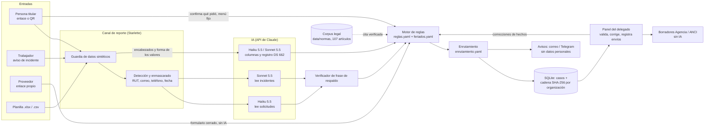

# Arquitectura técnica

Entregable 04 de ProductIA: diagrama, modelos, APIs, datos y dependencias. Estado al 17 de octubre de 2026.

**Principio:** la IA interpreta, el motor de reglas decide y la persona valida. Ningún plazo ni deber legal depende de la respuesta de un modelo.

## Diagrama

## Componentes

| Componente | Dónde | Qué hace | ¿Usa IA? |
| --- | --- | --- | --- |
| Corpus legal | `src/privacidad/corpus/`, `data/normas/` | Indexa por artículo la Ley 19.628 (texto fijado por la 21.719), la 21.719, el DS 662 y la Ley 21.663; verifica que cada cita exista y que el fragmento esté en el texto oficial. | No |
| Guardia de datos sintéticos | `src/privacidad/guardia.py` | Rechaza cualquier dato que podría ser real antes de procesarlo. | No |
| Detección y enmascarado | `src/privacidad/deteccion.py`, `rut.py` | Reemplaza RUT, correos, teléfonos y fechas por marcadores (`[RUT_1]`) antes de llamar a la IA. | No |
| Interpretación | `src/privacidad/interpretacion/` | Pide a la IA los hechos de un incidente o los derechos de una solicitud, con la frase del mensaje en que se basa. | Sí |
| Verificador de respaldo | `interpretacion/respaldo.py` | Comprueba que cada frase citada por la IA esté en el texto enmascarado. | No |
| Motor de reglas | `src/privacidad/motor/` | Decide deberes (Agencia, cada persona, ANCI) y plazos con reglas en YAML, cada una con fuente y vigencia; cuenta días hábiles con feriados verificados. Simulador de escenarios. | No |
| Canal de reporte | `src/privacidad/canal/` | Enlace firmado y QR, confirmación con la persona, modo reservado (Fernet), red de proveedores, enrutamiento, avisos y evidencia. | No (llama a la interpretación) |
| Inventario | `src/privacidad/inventario/` | Perfila planillas (edades y menores calculados por código), arma el registro de 11 campos del DS 662, la versión mínima y el riesgo de infracción. La planilla no se guarda. | Sí (columnas ambiguas y redacción del registro) |
| Borradores de reporte | `src/privacidad/reportes/` | Arma con código los borradores para la Agencia (art. 14 sexies) y la ANCI (alerta, actualización, informe final). | No |
| Panel del delegado | `src/privacidad/panel/` | Bandeja, ficha del caso, correcciones, validación, «Ya lo envié», registro de lo actuado, inventario, simulador. Demo con una copia por visitante. | No |
| Evaluación | `src/privacidad/evaluacion/`, `data/evaluacion/` | Mide 150 casos etiquetados en tres niveles: sin IA, IA sola, IA + motor. | Sí (solo al medir) |

## Modelos de IA

| Tarea | Modelo | Entrada | Salida |
| --- | --- | --- | --- |
| Leer solicitudes de personas | `claude-haiku-5-5` | Mensaje enmascarado | Derechos ejercidos, si hay que confirmar y la pregunta, frase de respaldo por derecho |
| Leer reportes de incidentes | `claude-sonnet-5-5` | Reporte enmascarado | Hechos (tipo de vulneración, categorías especiales, si es ciberincidente, etc.) con frase de respaldo |
| Clasificar columnas ambiguas | `claude-haiku-5-5` | Encabezado y forma de los valores (o valores enmascarados si son pocas opciones) | Categoría de dato y justificación |
| Redactar el registro de actividad | `claude-sonnet-5-5` | Resumen de columnas y descripción de la planilla | Campos del DS 662 en lenguaje simple |

Todas las llamadas usan salida estructurada con herramientas (esquema JSON fijo). El detalle de prompts, datos y supervisión está en [uso-de-ia.md](uso-de-ia.md).

## APIs (rutas HTTP)

Canal público (`src/privacidad/canal/web.py`), sin sesión:

| Ruta | Para qué |
| --- | --- |
| `GET/POST /canal/{org}/{firma}` | Formulario del canal de una organización (enlace firmado con `itsdangerous`) |
| `GET /canal/{org}/{firma}/qr.svg` | Código QR del enlace (`segno`) |
| `GET /seguimiento/{id}` y `POST …/confirmar` | Seguimiento con código y confirmación de lo que pidió la persona |
| `GET/POST /proveedor/{proveedor}/{firma}` | Reporte de un proveedor a todos sus clientes |
| `GET /salud` | Estado del servicio |

Panel del delegado (`src/privacidad/panel/web.py`), bajo `/panel`, con sesión y CSRF:

| Ruta | Para qué |
| --- | --- |
| `GET /` y `/bandeja/contenido` | Bandeja ordenada por urgencia (se actualiza con htmx) |
| `GET /caso/{id}` | Ficha del caso |
| `POST /caso/{id}/corregir · resolver · validar · enviado · derivar · identidad` | Acciones del delegado (cada una queda en la cadena de evidencia) |
| `GET /caso/{id}/borrador/{agencia\|anci}` (+ `descargar`, `revisado`) | Borradores de reporte |
| `GET/POST /inventario…` | Subir o analizar planillas, ver y validar el registro |
| `GET /simulador`, `/proveedores`, `/canal` | Simulador de escenarios, red de proveedores, enlace y QR |
| `GET /evidencia`, `POST /evidencia/revisar · simular` | Registro de lo actuado y prueba de alteración |
| `GET/POST /entrar`, `POST /salir` | Ingreso (scrypt, límite de intentos) |

Interfaz de línea de comandos: `python -m privacidad.canal servir | secreto | usuario | evidencia | correcciones`, `python -m privacidad.corpus`, `python -m privacidad.inventario`, `python -m privacidad.evaluacion`.

## Datos

| Dato | Dónde | Notas |
| --- | --- | --- |
| Reglas legales | `data/reglas/reglas.yaml`, `escenarios.yaml`, `riesgos.yaml`, `feriados.yaml` | Cada regla con fuente (norma, artículo, fragmento verificado) y vigencia |
| Textos legales | `data/normas/` | Textos oficiales del Diario Oficial; proyecto de ley en `proyectos/`, marcado «no es ley» |
| Organizaciones, áreas y proveedores | `data/canal/*.yaml` | Ficticios: Municipalidad Piloto, Comercial Los Robles, Clínica del Valle, Remuneraciones del Sur |
| Planillas de ejemplo | `data/sinteticos/comercial-los-robles/` | Generadas con semilla fija (`python -m privacidad.sinteticos`) |
| Casos de la demo | `data/demo/casos.yaml`, `data/demo/inventario_grabado.json` | Respuestas de la IA grabadas: la demo funciona sin conexión y sin costo |
| Set de evaluación | `data/evaluacion/` | 150 casos etiquetados (50 incidentes, 50 solicitudes, 50 columnas) |
| Casos y evidencia | SQLite (`casos.sqlite3` en la carpeta de datos) | Una cadena SHA-256 por organización; disparadores impiden cambiar o borrar la evidencia |
| Identidades reservadas | Misma base, cifradas con Fernet | La llave vive fuera del repositorio |

Solo datos sintéticos (bases del concurso, sección 11). La guardia rechaza lo que podría ser real.

## Dependencias

Librerías estándar y probadas antes que código propio:

| Librería | Uso |
| --- | --- |
| Biblioteca estándar: `sqlite3`, `hashlib` (SHA-256, scrypt), `smtplib`, `urllib`, `zoneinfo` | Casos, evidencia, contraseñas, avisos |
| `starlette`, `uvicorn`, `jinja2`, `python-multipart` | Servidor web y plantillas con escape automático |
| `pydantic` v2 | Modelos y validación de datos |
| `pyyaml` | Reglas y configuración |
| `cryptography` (Fernet) | Modo reservado |
| `itsdangerous` | Enlaces firmados |
| `segno` | Código QR |
| `babel`, `tzdata` | Fechas en español y zona horaria de Chile |
| `pandas`, `openpyxl` | Lectura de planillas |
| `anthropic` (opcional) | API de Claude |
| htmx 2.0.11, IBM Plex, Space Grotesk, Lucide | Incluidos en el repositorio, con sus licencias; nada se carga de internet |

## Despliegue

- **Render** (`render.yaml`, `Dockerfile`): plan de 0,5 CPU y 512 MB más disco persistente de 1 GB (US$7,25 al mes). Se publica solo si pasan las pruebas de GitHub Actions. Región Virginia (EE. UU.).
- **GitHub Actions**: pruebas en cada cambio (`ci.yml`); la IA real corre solo en el flujo manual `ia.yml`, con la llave como secreto del repositorio.
- **Piloto con datos reales** (plan): región Santiago de Google Cloud y PostgreSQL con una base por organización.

## Límites de la arquitectura

- Un solo servidor y SQLite: suficiente para el prototipo y un piloto pequeño, no para muchas organizaciones.
- La evidencia detecta alteraciones, pero borrar las últimas anotaciones solo se detecta si la huella final se guardó fuera del servidor. Un sello de tiempo externo (RFC 3161) queda para el plan a 90 días.
- Llave simétrica del modo reservado: quien administra el servidor y tiene la llave puede abrir identidades.
